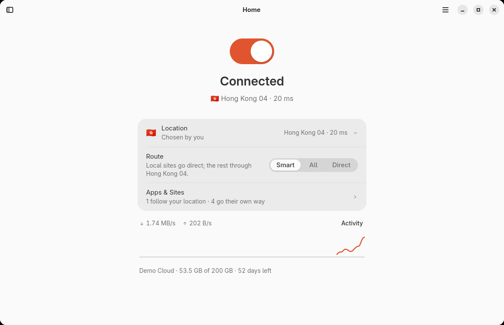

# Kairo

A clean, native [mihomo](https://github.com/MetaCubeX/mihomo) client for macOS and Linux, made for AI work:
your AI tools go out through one exit that stays put, and Kairo shows what each service sees. AppKit on the
Mac, GTK 4 and libadwaita on Linux, written in Rust on [NSH](https://nsh.dev).



## What it does

Five pages in a sidebar: **Home**, **Exits**, **Activity**, **Apps & Sites** and **Subscriptions**, with
Settings below them.

- **Three exits.** Traffic leaves through one of three places, each with a country, a server and a word for
  how it is doing (Good, OK, Slow): **AI**, **Everything else** and **Downloads**. The AI exit is pinned to a
  server (the same server, even if the provider renames it) and stays there when Everything else changes.
  Everything else is the fastest place by default, or the one you pick. Downloads (Hugging Face, PyPI,
  Ollama, Docker, GitHub) follow Everything else unless you pick another; a mirror switch, off until a
  throughput test passes, can shorten them. Pick a country, then a server, in **Exits**.
- **AI work.** Claude, ChatGPT, Gemini, Cursor, Copilot, Perplexity and Grok go through the AI exit. Kimi,
  DeepSeek, Doubao, Tongyi and the other domestic AI go direct, and local models (Ollama, LM Studio, your
  LAN) are never proxied. Home shows a row per service with what Kairo measured: whether it is reachable,
  whether its API answers (without a key), the country it sees (from Cloudflare's trace when the service sits
  behind it, otherwise a marked estimate), and whether a connection stays open for 90 seconds. The checks run
  when you connect and every ten minutes. When something is wrong, Home says so with one button: **Use AI
  Exit** or **Use Every App**. Kairo shows what a service sees; where you are and the service's own terms
  still apply. Settings → AI turns each part off.
- **Activity.** By app: what each one talks to (AI services first, then sites), where it goes through, and how
  much. A row's menu sets **Always Direct**, **Always AI Exit** or **Block** for that app, or shows its raw
  connections (with close). When an AI tool such as Claude Code goes around Kairo (it ignores the system
  proxy), a banner says so, with **Use Every App** (TUN) and **Copy for terminal** (an `export` line, with
  `NO_PROXY`). It reads the socket table of the current user only; no root.
- **Statistics.** Kairo records, on this computer only, how much went through each exit (per hour), which apps
  and AI services used it, whether each AI service was reachable and how fast its API answered, how each exit's
  server held up (a test every ten minutes) and every switch, and each subscription's use. Activity shows
  Today, 7 days or 30 days; a service's row opens its week; Exits has a Quality section; Subscriptions says
  whether the data lasts until the plan ends. History is kept 30 days in `stats.json` in Kairo's data folder;
  **Clear History** in Activity removes it. Nothing is sent anywhere.
- **Apps & Sites.** One list of choices: an app or a site goes through the AI exit, another country, direct,
  or is blocked. Everything not listed uses its usual exit.
- **Subscriptions.** Add a link or a YAML file; Kairo checks each one with the core before using it. Usage
  and expiry show on the row, and when a provider answers with an error or a notice, Kairo says it in plain
  words with a Retry. Updates run on a schedule (the provider's interval or your own) or by hand.
- **Updates.** Kairo checks for a new release at launch and every six hours. When there is one, the sidebar's
  foot shows **Download**; it downloads and verifies the release (an Ed25519-signed manifest, plus
  `SHA256SUMS`), then offers **Restart**. The app bundle on macOS, the files of a `~/.local` install, or the
  `.deb` through `pkexec apt-get` (one password prompt) are replaced, core included.
- **Core.** The official mihomo build is inside every package, pinned and checked against its published
  SHA-256 when the package is built. It starts with Kairo (all traffic goes direct until you add a
  subscription) and comes back if it crashes. A custom core binary also works.
- **System proxy and TUN.** Apps follow the system settings (macOS `networksetup`, GNOME gsettings, KDE
  kioslaverc), or **Every app** takes everything in through TUN. The previous settings are put back on quit,
  on SIGTERM or SIGINT, on a panic, and even after a SIGKILL or crash, thanks to a small guardian process.
  The core alone gets the one-time privilege TUN needs (`cap_net_admin` through `pkexec setcap` on Linux,
  setuid through the administrator prompt on macOS). Kairo itself never runs privileged. See
  [TUN and privileges](#tun-and-privileges).
- **Settings.** General: appearance, launch at login, start minimized, keep running in the tray, how apps
  follow, AI. **Advanced**: the port, other devices on the network, IPv6, the bypass list, the controller and
  secret, the core, the delay test, and **Inspect**: the subscription's groups, the running rules
  (read-only), Diagnostics (the core's log and a report to copy) and DNS (ask the core's resolver; flush
  the fake-IP cache).
- **Menu bar / tray.** Status and speeds, mode, the AI line, Everything else and AI exit by country, start or
  stop, open a page, and quit. ⌘K finds pages, actions and places.

## Install

Download the latest release from [Releases](https://github.com/daoleno/kairo/releases/latest), or from the
[website](https://daoleno.github.io/kairo/).

- **macOS 11+** (Apple silicon and Intel): open the `.dmg` and drag Kairo to Applications. The app is ad hoc
  signed but not notarized, so macOS stops it the first time. Open Kairo once, then go to System Settings →
  Privacy & Security and click **Open Anyway** next to Kairo. Or run
  `xattr -dr com.apple.quarantine /Applications/Kairo.app` before opening it.
- **Debian / Ubuntu 24.04+**: `sudo apt install ./kairo_<version>_amd64.deb` (or `_arm64`).
- **Other Linux** (GTK 4.14+, libadwaita 1.5+, WebKitGTK 6.0): unpack the `.tar.gz` and run `./install.sh`, which installs
  to `~/.local`; `./install.sh /usr/local` installs system-wide with sudo.

Check downloads against `SHA256SUMS` in the release. After that, Kairo updates itself.

## Build and run

Rust (stable) and the platform's development libraries are needed: GTK 4 on Linux, Xcode's command line tools
on macOS.

```sh
scripts/fetch-mihomo.sh        # target/mihomo/: the pinned core (scripts/mihomo.env), checksum verified
cargo run                      # the app (GTK 4 on Linux, AppKit on macOS), with that core
nsh check                      # cargo check of every crate
scripts/ui-test.sh             # nsh test: all unit, e2e and headless UI tests
scripts/tun-e2e.sh             # TUN end to end, in a network namespace
scripts/package-linux.sh       # dist/: a tarball with the binary, the core, .desktop file, icons and install.sh
scripts/package-deb.sh         # dist/: a .deb from that tree
scripts/package-macos.sh       # dist/: Kairo.app, .dmg and .zip, universal, ad hoc signed (run on a Mac)
```

Kairo keeps its data in `~/.local/share/kairo` on Linux and `~/Library/Application Support/Kairo` on macOS.
`KAIRO_HOME` overrides the location. `KAIRO_NO_SYSPROXY=1` makes Kairo leave the system proxy alone, which is
useful for development next to a proxy you rely on. `KAIRO_NO_UPDATE=1` turns off the update checks.
On first run Kairo takes ports 7897 and 9097, or the next free ones if another client holds them.

### Tests

- `cargo test -p kairo-core` runs the unit tests: config merging, subscriptions, usage headers, settings,
  the system proxy formats of each desktop, the bundled core, and the updater (signatures, checksums,
  install detection, replacing a `~/.local` install).
- `tests/e2e.rs` runs against a real core on free ports. It serves a subscription and runs two local proxy
  nodes and an origin, then drives the service as the app does:
  - start the bundled core with no profile, then add the profile;
  - pick a node and test delays;
  - send traffic through the core and check it in the connections and traffic streams;
  - check rules, logs and the DNS tool;
  - switch modes;
  - try a bad override, which is refused;
  - kill the core, which comes back with its selection intact;
  - stop.
- `tun_in_a_network_namespace` turns TUN on and off for real, under `unshare -rn`. That gives a user and
  network namespace with uid 0 inside, so no root is needed and the host's network is not touched.
- `tests/app.test.tsx` runs headless under `nsh test` with the real core and `scripts/fixture.py`. It covers
  the first run, adding a subscription, the exits, modes, the double press on the connect switch, apps &
  sites, groups, rules, logs, DNS, settings (Apply/Revert) and dark mode.

## Architecture

```
src/main.rs          the launcher: window, tray, single instance, signals, guardian process
src/lib.rs           the NSH root component (App) and the sidebar shell
src/pages/*.rs       Home, Exits, Activity, Apps & Sites, Subscriptions, Settings (and its Inspect views)
src/ui/              the small design system: tokens, rows, groups, segmented controls, icons
crates/kairo-core    everything that is not UI:
  service.rs           the state (a tokio watch channel the UI subscribes to) and every action
  supervisor.rs        starts, watches and stops the core; restarts it after a crash
  controller.rs        mihomo's REST API and its streams (/traffic, /memory, /connections, /logs)
  config.rs            the running config: profile + override + Kairo's settings; validation by the core
  profile.rs           subscriptions and files, usage headers, update schedule
  core_bin.rs          the bundled core: Kairo's own copy of it, its version
  update.rs            Kairo's updates: signed manifest, download, checks, install, relaunch
  sysproxy.rs          system proxy on macOS, GNOME and KDE: set, restore, recover
  tun.rs               TUN privilege: status and the one-time grant
  autostart.rs         launch at login (XDG autostart, LaunchAgent)
crates/kairo-tray    the StatusNotifierItem (ksni) on Linux, NSStatusItem on macOS
```

The UI never blocks: actions run on the service's tokio runtime, and the pages render from its state through
NSH signals. Long lists (connections, rules, logs) are virtual lists keyed by id.

## TUN and privileges

TUN needs the right to create a network device and change routes. Kairo gives that right to the core binary
alone, once:

- **Linux**: `pkexec setcap cap_net_admin,cap_net_bind_service=+ep <core>`. Polkit asks for the password once,
  and the core can then run TUN as your user. If Kairo runs as root, or as uid 0 inside a user namespace,
  nothing is needed.
- **macOS**: the core is made setuid root through the system's administrator prompt.

The grant goes to Kairo's own copy of the core in its data directory, never to a file inside the app or a
system package. An update that brings a new mihomo version replaces that copy, which drops the grant: Kairo
then turns TUN off, says so, and asks again the next time you switch it on.

## Releasing (maintainers)

Releases are built by GitHub Actions (`.github/workflows/release.yml`) when a `vX.Y.Z` tag is pushed that
matches `Cargo.toml`. The notes come from `docs/releases/vX.Y.Z.md`. Running the workflow by hand builds
everything without publishing.

The workflow signs the update manifest (`kairo-update.json`) with the `KAIRO_UPDATE_KEY` secret, an Ed25519
key whose public half is built into Kairo (`crates/kairo-core/src/update.rs`). A recovery copy of the private
key is kept offline by the maintainer. Without it, a lost secret would leave every installed Kairo unable to
update.

To ship a newer mihomo, change `scripts/mihomo.env` (version and checksums) and release Kairo.

## Licence

Kairo is free software under the [GNU General Public License v3.0 or later](LICENSE).

Kairo ships [mihomo](https://github.com/MetaCubeX/mihomo) (© MetaCubeX), free software under the
[GNU GPL v3.0](https://github.com/MetaCubeX/mihomo/blob/Meta/LICENSE): the official release build, unmodified
(on macOS, the Apple silicon and Intel builds joined into one file). The version is pinned in
[`scripts/mihomo.env`](scripts/mihomo.env); its source is at `https://github.com/MetaCubeX/mihomo/tree/<version>`.
Each package carries mihomo's licence and a notice with that link (`share/doc/kairo/` on Linux,
`Kairo.app/Contents/Resources/` on macOS). You can also point Kairo at a core you built yourself
(Settings → Core).
