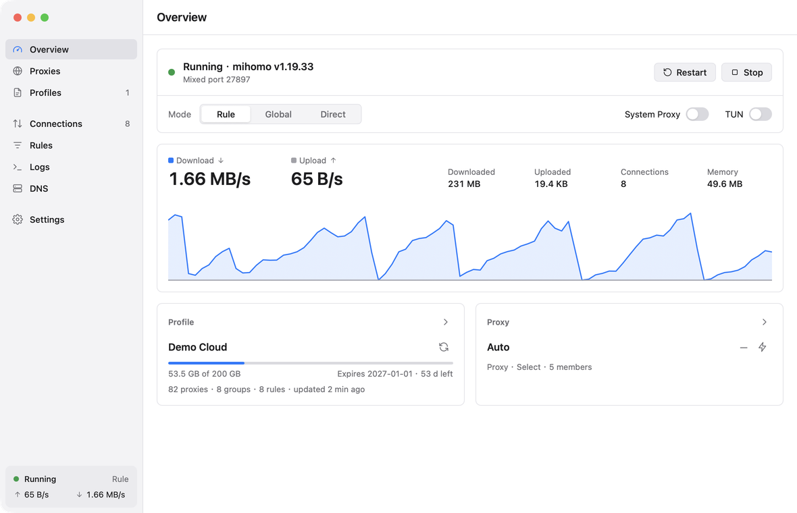

# Kairo

A native desktop client for the [mihomo](https://github.com/MetaCubeX/mihomo) proxy core (Clash Meta), for
Linux (GTK 4) and macOS (AppKit), written in Rust on [NSH](https://nsh.dev).

Kairo ships with the core and keeps it running: open it and the proxy is up. It manages your subscriptions, lets you pick nodes, and shows live
traffic, connections, rules and logs. It can also set the system proxy or turn on TUN. The layout is dense and
calm, with one accent colour, and it follows the system's light or dark appearance.


<p align="center"></p>

## What it does

- **Core**: the official mihomo build is inside every package, pinned and checked against its published
  SHA-256 when the package is built. It starts with Kairo (all traffic goes direct until you add a profile)
  and comes back if it crashes. A custom core binary also works.
- **Updates**: Kairo checks for a new release on launch and every six hours, downloads it in the
  background and verifies it (an Ed25519-signed manifest, plus `SHA256SUMS`). **Restart to Update** installs
  it, core included: the app bundle on macOS, the files of a `~/.local` install, or the `.deb` through
  `pkexec apt-get` (one password prompt).
- **Profiles**: add a subscription URL or a YAML file. Kairo validates each one with the core before using it.
  Subscriptions update on a schedule (the provider's interval or your own) or by hand. You can see usage and
  expiry, switch profiles with one click, and keep per-profile overrides in a YAML editor. Overrides merge
  into the profile, `prepend-rules` and friends are supported, and the core checks the result before Kairo
  applies it.
- **Proxies**: see groups in config order, pick a node, and run delay tests for one node or a whole group.
  Nodes can be sorted by delay or name and filtered. Proxy providers support update and health check.
- **Modes**: Rule, Global and Direct. Switch from the Overview or the tray; the sidebar shows the current mode.
- **System proxy**: works on macOS (`networksetup`), GNOME (gsettings) and KDE (kioslaverc). The previous
  settings are put back on quit, on SIGTERM or SIGINT, on a panic, and even after a SIGKILL or crash, thanks to
  a small guardian process. The next start also recovers any leftover state. Kairo only puts back what it
  changed: if its System Proxy was never on, another app's proxy settings are left alone.
- **TUN**: one switch. The core alone gets the one-time privilege it needs: `cap_net_admin` through
  `pkexec setcap` on Linux, setuid through the administrator prompt on macOS. Kairo itself never runs
  privileged. See [TUN and privileges](#tun-and-privileges).
- **Live views**: a traffic graph, totals and memory. The connections table (sortable and searchable, with an
  inspector and close or close-all) stays smooth with thousands of rows. You also get the rules and rule
  providers, and the logs (live level, search, pause).
- **DNS tool**: query the core's resolver for A, AAAA, CNAME, MX, TXT or NS records, and flush the fake-IP cache.
- **Settings**: ports, LAN, IPv6, bypass list, TUN stack, controller and secret, delay test URL, appearance,
  launch at login, start minimized, keep running in the tray, and the tray's quick-switch group.
- **Tray / menu bar**: status and speeds, mode, system proxy, TUN, node quick switch, start/stop the core,
  show the window, and quit.

## Install

Download the latest release from [Releases](https://github.com/daoleno/kairo/releases/latest), or from the
[website](https://daoleno.github.io/kairo/).

- **macOS 11+** (Apple silicon and Intel): open the `.dmg` and drag Kairo to Applications. The app is ad hoc
  signed but not notarized, so macOS stops it the first time. Open Kairo once, then go to System Settings →
  Privacy & Security and click **Open Anyway** next to Kairo. Or run
  `xattr -dr com.apple.quarantine /Applications/Kairo.app` before opening it.
- **Debian / Ubuntu 24.04+**: `sudo apt install ./kairo_<version>_amd64.deb` (or `_arm64`).
- **Other Linux** (GTK 4.14+, libadwaita 1.5+, WebKitGTK 6.0): unpack the `.tar.gz` and run `./install.sh`, which installs
  to `~/.local`; `./install.sh /usr/local` installs system-wide with sudo.

Check downloads against `SHA256SUMS` in the release. After that, Kairo updates itself.

## Build and run

Rust (stable) and the platform's development libraries are needed: GTK 4 on Linux, Xcode's command line tools
on macOS.

```sh
scripts/fetch-mihomo.sh        # target/mihomo/: the pinned core (scripts/mihomo.env), checksum verified
cargo run                      # the app (GTK 4 on Linux, AppKit on macOS), with that core
nsh check                      # cargo check of every crate
scripts/ui-test.sh             # nsh test: all unit, e2e and headless UI tests
scripts/tun-e2e.sh             # TUN end to end, in a network namespace
scripts/package-linux.sh       # dist/: a tarball with the binary, the core, .desktop file, icons and install.sh
scripts/package-deb.sh         # dist/: a .deb from that tree
scripts/package-macos.sh       # dist/: Kairo.app, .dmg and .zip, universal, ad hoc signed (run on a Mac)
```

Kairo keeps its data in `~/.local/share/kairo` on Linux and `~/Library/Application Support/Kairo` on macOS.
`KAIRO_HOME` overrides the location. `KAIRO_NO_SYSPROXY=1` makes Kairo leave the system proxy alone, which is
useful for development next to a proxy you rely on. `KAIRO_NO_UPDATE=1` turns off the update checks.
On first run Kairo takes ports 7897 and 9097, or the next free ones if another client holds them.

### Tests

- `cargo test -p kairo-core` runs the unit tests: config merging, subscriptions, usage headers, settings,
  the system proxy formats of each desktop, the bundled core, and the updater (signatures, checksums,
  install detection, replacing a `~/.local` install).
- `tests/e2e.rs` runs against a real core on free ports. It serves a subscription and runs two local proxy
  nodes and an origin, then drives the service as the app does:
  - start the bundled core with no profile, then add the profile;
  - pick a node and test delays;
  - send traffic through the core and check it in the connections and traffic streams;
  - check rules, logs and the DNS tool;
  - switch modes;
  - try a bad override, which is refused;
  - kill the core, which comes back with its selection intact;
  - stop.
- `tun_in_a_network_namespace` turns TUN on and off for real, under `unshare -rn`. That gives a user and
  network namespace with uid 0 inside, so no root is needed and the host's network is not touched.
- `tests/app.test.tsx` runs headless under `nsh test` with the real core and `scripts/fixture.py`. It covers
  the first run, adding a subscription, proxies and delay tests, modes, rules, logs, DNS, settings
  (Apply/Revert) and dark mode.

## Architecture

```
src/main.rs          the launcher: window, tray, single instance, signals, guardian process
src/lib.rs           the NSH root component (App) and the sidebar shell
src/pages/*.rs       Overview, Proxies, Profiles, Connections, Rules, Logs, DNS, Settings
src/ui/              the small design system: tokens, rows, groups, segmented controls, icons
crates/kairo-core    everything that is not UI:
  service.rs           the state (a tokio watch channel the UI subscribes to) and every action
  supervisor.rs        starts, watches and stops the core; restarts it after a crash
  controller.rs        mihomo's REST API and its streams (/traffic, /memory, /connections, /logs)
  config.rs            the running config: profile + override + Kairo's settings; validation by the core
  profile.rs           subscriptions and files, usage headers, update schedule
  core_bin.rs          the bundled core: Kairo's own copy of it, its version
  update.rs            Kairo's updates: signed manifest, download, checks, install, relaunch
  sysproxy.rs          system proxy on macOS, GNOME and KDE: set, restore, recover
  tun.rs               TUN privilege: status and the one-time grant
  autostart.rs         launch at login (XDG autostart, LaunchAgent)
crates/kairo-tray    the StatusNotifierItem (ksni) on Linux, NSStatusItem on macOS
```

The UI never blocks: actions run on the service's tokio runtime, and the pages render from its state through
NSH signals. Long lists (connections, rules, logs) are virtual lists keyed by id.

## TUN and privileges

TUN needs the right to create a network device and change routes. Kairo gives that right to the core binary
alone, once:

- **Linux**: `pkexec setcap cap_net_admin,cap_net_bind_service=+ep <core>`. Polkit asks for the password once,
  and the core can then run TUN as your user. If Kairo runs as root, or as uid 0 inside a user namespace,
  nothing is needed.
- **macOS**: the core is made setuid root through the system's administrator prompt.

The grant goes to Kairo's own copy of the core in its data directory, never to a file inside the app or a
system package. An update that brings a new mihomo version replaces that copy, which drops the grant: Kairo
then turns TUN off, says so, and asks again the next time you switch it on.

## Releasing (maintainers)

Releases are built by GitHub Actions (`.github/workflows/release.yml`) when a `vX.Y.Z` tag is pushed that
matches `Cargo.toml`. The notes come from `docs/releases/vX.Y.Z.md`. Running the workflow by hand builds
everything without publishing.

The workflow signs the update manifest (`kairo-update.json`) with the `KAIRO_UPDATE_KEY` secret, an Ed25519
key whose public half is built into Kairo (`crates/kairo-core/src/update.rs`). A recovery copy of the private
key is kept offline by the maintainer. Without it, a lost secret would leave every installed Kairo unable to
update.

To ship a newer mihomo, change `scripts/mihomo.env` (version and checksums) and release Kairo.

## Licence

Kairo is free software under the [GNU General Public License v3.0 or later](LICENSE).

Kairo ships [mihomo](https://github.com/MetaCubeX/mihomo) (© MetaCubeX), free software under the
[GNU GPL v3.0](https://github.com/MetaCubeX/mihomo/blob/Meta/LICENSE): the official release build, unmodified
(on macOS, the Apple silicon and Intel builds joined into one file). The version is pinned in
[`scripts/mihomo.env`](scripts/mihomo.env); its source is at `https://github.com/MetaCubeX/mihomo/tree/<version>`.
Each package carries mihomo's licence and a notice with that link (`share/doc/kairo/` on Linux,
`Kairo.app/Contents/Resources/` on macOS). You can also point Kairo at a core you built yourself
(Settings → Core).
